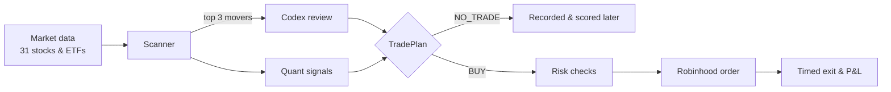

# TradeAgent

**An AI analyst picks the trade. A deterministic engine places it.**

TradeAgent scans US stocks and ETFs, asks a coding agent (Codex) to sanity-check the most
interesting moves, runs the survivors through cost-aware quantitative checks, and trades
them on Robinhood with automatic exits. Every forecast is written down before the market
answers, so you always know which picks were actually right.

[](https://github.com/danielye0010/TradeAgent/actions/workflows/ci.yml)


[](LICENSE)

[How it works](#how-it-works) · [Quick start](#quick-start) · [Trading modes](#trading-modes) · [Daily autopilot](#daily-autopilot) · [Strategies](#strategies) · [Docs](#documentation)

## How it works



The split is deliberate. **The model decides what is worth a look; it never touches the
broker.** Sizing, risk limits, order placement, exits and reconciliation live in plain
Python that behaves the same way every time.

A typical day on the [daily autopilot](#daily-autopilot), which paper-trades:

| Time (ET) | What happens |
| --- | --- |
| 10:00 | Pull fresh bars and quotes, rank the most unusual moves |
| 10:01 | Codex reviews the top three and returns *long*, *watch* or *avoid* |
| 10:02 | Quant signals and cost estimates are frozen into a decision |
| 10:05 | The modeled entry window opens |
| 11:05 | The modeled position closes |
| 17:00 | Every forecast is scored against what the market actually did |

Real orders only happen when you start a [live mode](#trading-modes) yourself; it follows
the same entry-then-timed-exit shape for the plan you approve.

## Quick start

TradeAgent runs on Linux with Python 3.12+. WSL2 on Windows works too.

```bash
git clone https://github.com/danielye0010/TradeAgent.git
cd TradeAgent
python3 -m venv .venv && source .venv/bin/activate
pip install -e ".[dev]"
```

Prebuilt wheels with checksums are on the [Releases](https://github.com/danielye0010/TradeAgent/releases) page.

Two things to try right away, no accounts needed:

```bash
# Simulated strategy lab: predictions, outcomes, learning and challengers on synthetic data
tradeagent demo --demo-dir work/demo
tradeagent inspect --state-dir work/demo

# A full buy-and-sell round trip against a simulated broker
tradeagent run-once --paper --state-dir work/paper
```

Keep state directories on a local Linux disk (ext4, btrfs or xfs). SQLite locking is
unreliable on network shares and Windows mounts, so TradeAgent refuses them.

### Connect market data

Live scanning uses the official
[Robinhood Trading MCP](https://robinhood.com/us/en/support/articles/agentic-trading-overview/).
TradeAgent never sees your password. You provide a small helper executable that prints a
token, and TradeAgent calls it when it needs one:

```json
{"access_token": "...", "expires_at": 1767225600, "resource": "https://agent.robinhood.com/mcp/trading"}
```

Put it at `~/.local/libexec/robinhood-mcp-oauth-helper` (or pass `--oauth-helper`).
Details are in the [helper contract](docs/prospective-shadow.md#robinhood-setup).
Prefer Alpaca for data? Add `--provider alpaca` to `scan`.

Then run a research pass by hand:

```bash
tradeagent opportunity scan --candidates 3                        # rank today's unusual movers
tradeagent opportunity evidence --template > work/assessment.json # the form Codex fills in
tradeagent opportunity assess --input work/assessment.json
tradeagent opportunity decide --refresh                           # freeze a TradePlan or NO_TRADE
tradeagent opportunity show
```

## Trading modes

Open [Codex](https://github.com/openai/codex) in the repo and talk to the
`trade-opportunity-analyst` skill. It runs the commands above for you, reads the news
for each candidate, and explains its reasoning.

| Mode | Say this | What happens |
| --- | --- | --- |
| **Research** | `$trade-opportunity-analyst Analyze today's market and generate a TradePlan.` | Full analysis, no orders |
| **Live** | `$trade-opportunity-analyst LIVE: analyze today's market, show the purchase plan, execute if eligible, and report P&L.` | Trades only when the strategy has a statistically supported edge for that setup |
| **Experimental live** | `$trade-opportunity-analyst EXPERIMENTAL LIVE: trade today's strongest quant signal with my $5 setting.` | One small position per day on the best quant signal, so you can learn from real fills |

Both live modes use the same execution engine and your private config:

```toml
[live]
enabled = true
symbols = ["QQQ", "IWM", "AAPL", "MSFT"]   # what the agent is allowed to buy
state_dir = "/abs/path/to/state"
max_notional = "25"

[broker]
oauth_helper = "/abs/path/to/robinhood-mcp-oauth-helper"

[entry]
order_type = "market"
dollar_amount = "5"
```

Before the first live trade, run `tradeagent live-check --config tradeagent.toml`. It reads
your account, quotes and permissions without placing anything. Drop a file named `KILL`
in `state_dir` at any time to close the position and stop. If anything interrupts a
trade, `tradeagent recover --config tradeagent.toml` picks up where it left off and only
ever exits. The full reference is in [Live execution](docs/one-shot.md).

## Daily autopilot

One command installs a systemd timer that runs the research loop every trading day, with
no chat window involved:

```bash
python scripts/install_shadow.py --daily \
  --python "$PWD/.venv/bin/python" \
  --state-dir /abs/path/to/daily-research
```

At 10:00 ET it scans the market and asks Codex (via `codex exec`, logged in with your
ChatGPT account) to rank the top three candidates from the price and volume data. Then it
records four competing picks:

| Arm | How it picks |
| --- | --- |
| **Quant only** | Strongest quantitative signal |
| **Codex only** | Codex's top-ranked *long* |
| **Quant + Codex** | Best name that both agree on |
| **Random** | A seeded coin flip among the same candidates, or cash |

### Does reading the news help?

A second timer runs the same idea at 10:30 ET, but asks Codex twice about the same three
candidates: once from price data only, and once with live web search for news, filings and
analyst actions, citing every source it relied on.

```bash
python scripts/install_shadow.py --daily --protocol daily-news-v2 \
  --python "$PWD/.venv/bin/python" \
  --state-dir /abs/path/to/daily-news
```

Both picks get the same entry, exit and costs, so the gap between **Codex news** and
**Codex price** is exactly what the news is worth.

### Reading the results

Each existing v1/v2 timer writes `daily-status.json` and `daily-report.md` after its
normal tick. The report separates frozen modeled P&L from exploratory candidate
selection statistics: a cost-adjusted equal-weight basket of the same eligible
candidates, complete Price/News rankings, daily rank association, ordering accuracy,
selection disagreement and observed news-search activity. Missing evidence remains
PENDING or UNAVAILABLE; failed assessments are never counted as profitable CASH.

Quant + Codex requires a positive Quant signal and Codex support for the selected
symbol, without requiring identical first choices. Ranking statistics describe the
entire frozen shortlist; candidate pairs do not count as independent trading days.
Longitudinal differences use matched daily sessions, separated by evidence pool.
These exploratory diagnostics do not change the original trading metrics or establish
a repeatable edge. Reports retain each final decision quote and its frozen costs;
v2's refreshed quote may differ from its earlier scanner quote.

Regenerate a report from saved evidence without collecting data or calling Codex:

```bash
python -m tradeagent.prospective.daily --report-only \
  --state-dir /abs/path/to/daily-news --protocol daily-news-v2
```

The autopilot paper-trades only; real orders always come from one of the live modes above.

## Strategies

Three intraday hypotheses, each evaluated on 5-minute-delayed entries with a one-hour hold:

| Strategy | The bet |
| --- | --- |
| **Opening continuation** | A strong open that agrees with the gap and the market keeps going |
| **Stabilized reversal** | A big opening move that starts to stall is about to retrace |
| **Residual strength** | A stock outrunning the market on a beta-adjusted basis keeps outrunning it |

Spread, slippage and fees are subtracted before anything counts as a win. Bearish signals
are recorded but never shorted.

**Where things stand:** this is a beta, and no strategy has shown a repeatable edge yet.
Early numbers are in [Alpha findings](docs/alpha-findings.md); the daily autopilot exists
to change that answer with real data.

## Project layout

```text
.agents/skills/trade-opportunity-analyst/   the Codex skill
src/tradeagent/
  research/       scanner, signals, TradePlans, outcome tracking
  prospective/    daily autopilot and market-data providers
  oneshot.py      live entry, exit and recovery engine
  risk.py         position, exposure and cash limits
scripts/          systemd installers and release checks
docs/             design notes and operating guides
```

## Documentation

- [Opportunity workflow](docs/opportunity-workflow.md): every command and how decisions are made
- [Live execution](docs/one-shot.md): config reference, recovery, kill switch
- [Daily autopilot and shadow trading](docs/prospective-shadow.md)
- [Architecture](docs/architecture.md) and [research protocol](docs/research-protocol.md)
- [Changelog](CHANGELOG.md) and [release workflow](docs/releasing.md)

## Development

```bash
pytest -q
ruff check src tests scripts
ruff format --check src tests scripts
```

The test suite uses synthetic markets and a mock broker, so it runs offline in about two
minutes. CI covers Python 3.12 through 3.14 and smoke-tests the built wheel.

## License

[Apache 2.0](LICENSE), with some vendored MIT components ([details](THIRD_PARTY.md)).

TradeAgent is an independent project and is not affiliated with Robinhood Markets, Inc.
Trading involves risk of loss.
