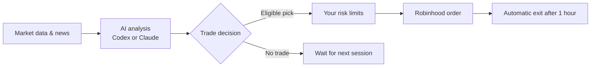

# TradeAgent

**English** | [简体中文](README.zh-CN.md)

**Your own AI trading agent, with a public track record.**

[](https://github.com/danielye0010/TradeAgent/actions/workflows/ci.yml)
[](https://pypi.org/project/tradeagent/)
[](LICENSE)

TradeAgent is an open-source AI agent that runs on your computer. Every trading morning it
reads the news, picks one US stock or ETF (or stays in cash) and explains why. Turn on
automatic trading and it buys that pick on Robinhood with a small amount you choose and
sells it an hour later, while a deterministic engine enforces your limits.

Every pick is frozen before the market moves and scored against SPY and a random pick
from the same shortlist, so you can see whether the AI actually helps.
**[See the public track record →](https://danielye0010.github.io/TradeAgent/)**

- **It trades for you, within hard limits.** Your symbols, $1–$5 a trade, one trade a
  day, sold after an hour. The AI only picks; the engine places and checks every order.
- **It shows its work.** Each pick comes with its reasoning and news sources, and the
  record includes the losing days.
- **Pick its brain: GPT or Claude.** The agent runs on Codex (GPT) by default. Add Claude
  to answer the same question on the same stocks, compare them, and choose whose pick to trade.
- **No API keys.** It uses the ChatGPT and Claude subscriptions you already have, and
  Robinhood's official browser login.
- **See everything.** A local dashboard shows your account, every trade and every pick.

## A trading day

| New York time | What happens |
| --- | --- |
| 10:30 | The AI looks at three of the day's most unusual movers, reads the news and picks one, or none. |
| about 10:36 | If the pick is on your list, TradeAgent buys your amount. |
| one hour later | It sells automatically. |
| any time | Open the dashboard to see the pick, the reasoning and the result. |

No eligible pick, a missed start or a failed check means no trade that day.



## Get started

You need Linux or WSL2, Python 3.12+, a ChatGPT account with Codex access and an
eligible Robinhood agentic account. Claude is optional and needs a Claude Pro, Max, Team
or Enterprise plan. Run everything as the same Linux user, on the local Linux filesystem.

**1. Install**

```bash
git clone https://github.com/danielye0010/TradeAgent.git
cd TradeAgent
python3 -m venv .venv
source .venv/bin/activate
pip install .
curl -fsSL https://chatgpt.com/codex/install.sh | sh
```

Just want to try the command and the dashboard? `pipx install tradeagent` installs the same
`tradeagent` command from [PyPI](https://pypi.org/project/tradeagent/). Automatic trading
below uses the checkout's research installer, so clone the repository for that.

**2. Connect your accounts.** Open a new terminal, return to the checkout and activate `.venv`:

```bash
codex login              # ChatGPT browser sign-in
tradeagent login         # Robinhood browser sign-in; creates your configuration
tradeagent doctor        # checks your setup and tells you what is missing
tradeagent live-check    # checks account access and quotes; places no orders
```

**3. Open the dashboard**

```bash
tradeagent dashboard
```

Nothing trades yet. Installing, signing in and opening the dashboard never place an
order. See the [setup guide](docs/getting-started.md) if a step fails.

## Turn on automatic trading

**1. Set your limits** in `~/.config/tradeagent/tradeagent.toml` (created by
`tradeagent login`). Keep the other generated settings:

```toml
[live]
enabled = true
symbols = ["QQQ", "IWM"]   # only these symbols may be bought
max_notional = "25"        # per-entry ceiling in dollars

[entry]
order_type = "market"
dollar_amount = "5"        # $1–$5 per trade

[exit]
order_type = "market"
hold_seconds = 3600        # sell after one hour
```

**2. Start the daily AI research.** It makes and records the pick each morning; it never trades.

```bash
python scripts/install_shadow.py --daily --protocol daily-news-v2 \
  --python "$PWD/.venv/bin/python" \
  --state-dir "$HOME/.local/state/tradeagent/daily-decisions"
```

**3. Start trading the pick**

```bash
tradeagent autotrade install --enable
systemctl --user list-timers tradeagent-daily-news.timer tradeagent-autotrade.timer
```

Your computer, with Linux or WSL running, needs to be awake from 10:30 until the sale
about an hour later. The timers look for `codex` (and `claude`) in `~/.local/bin`,
`/usr/local/bin`, `/usr/bin` or `/bin`, where the installers put them. To stop: `tradeagent autotrade uninstall`. More in
[automatic trading](docs/autotrade.md).

## Add Claude (optional)

Claude gets the same three stocks, the same market data and the same question as Codex
at the same minute, and its pick is scored over the same hour with the same costs. The
dashboard's **GPT vs Claude** page shows who is ahead, how often they agree and each
model's reasoning, session by session. It runs on your Claude subscription, not an API key.

```bash
curl -fsSL https://claude.ai/install.sh | bash
claude                              # sign in once with your Claude plan
tradeagent claude doctor --probe    # checks the sign-in and asks Claude once
tradeagent claude install --enable  # runs next to the daily research
```

Claude only does research until you choose to trade its pick:

```bash
tradeagent autotrade install --model claude --enable   # trade Claude's pick
tradeagent autotrade install --enable                  # back to Codex (default)
```

A few days of results are mostly luck; the page gives a verdict after 20 trading
days. See [GPT vs Claude](docs/claude.md).

## The dashboard

`tradeagent dashboard` opens a local page in your browser. It only reads; it never trades.

| Page | What you see |
| --- | --- |
| **Account** | Account value and profit, a chart you can scrub, today's trade and recent trades. |
| **Decisions** | Today's schedule, each frozen AI pick and why it was made. |
| **GPT vs Claude** | Who is ahead, how often they agree, every day's picks and both models' reasoning. |
| **Research** | Each strategy's results against SPY and a random pick. |
| **Trades** | Every trade with prices, times and total profit. |

Want others to follow along? `tradeagent publish install` puts the paper results (never
your account) on a public track-record page like [ours](https://danielye0010.github.io/TradeAgent/) after every close. See
[publishing](docs/publish.md).

## Ask the agent yourself

Run `codex` from the checkout and ask for an analysis:

```text
$trade-opportunity-analyst Analyze today's market and generate a TradePlan.
```

It explains the candidates and the trade it would make, without placing an order. To
place one trade from your settings yourself, use `tradeagent run-once --live`. See
[manual trading and recovery](docs/one-shot.md).

## Safety

- The AI only picks. The execution engine enforces your settings: fresh quotes, an
  allowed symbol, regular market hours, and enough cash within your position, exposure
  and loss limits.
- No leverage and no short selling. Orders are recorded before they are sent and are
  never blindly retried.
- Emergency stop: create a `KILL` file in the live state directory. It blocks new buys
  and lets the open position exit.
- If the computer sleeps or the connection drops during a trade, check with
  `tradeagent status` and finish the exit with `tradeagent recover`.

AI picks can lose money. Start small.

## Documentation

[Setup](docs/getting-started.md) · [Automatic trading](docs/autotrade.md) ·
[Dashboard](docs/dashboard.md) · [GPT vs Claude](docs/claude.md) · [Public results page](docs/publish.md) ·
[Manual trading](docs/one-shot.md) ·
[Architecture](docs/architecture.md) · [Contributing](CONTRIBUTING.md) · [Changelog](CHANGELOG.md)

## License

[Apache 2.0](LICENSE), with some vendored MIT components ([details](THIRD_PARTY.md)).

## Weekly paper portfolios

`tradeagent weekly` runs the independent [weekly-hold-v1 SHADOW study](docs/weekly-hold-v1.md):
Codex, Claude, 12–1 momentum, random and SPY each start with $10,000 of virtual cash.
Cross-week holdings, settlement sensitivity, missing observations and every group
are retained. View `/weekly` in the dashboard or the public [weekly page](https://danielye0010.github.io/TradeAgent/#weekly).
This experimental protocol places no real orders and does not authorize LIVE.
