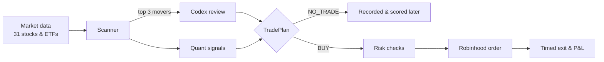

# TradeAgent

**English** | [简体中文](https://github.com/danielye0010/TradeAgent/blob/main/README.zh-CN.md)

**An AI analyst picks the trade. Plain, tested Python places it.**

TradeAgent scans US stocks and ETFs, asks a coding agent (Codex) to review the most
unusual moves, and trades the best of them on Robinhood through the official agentic
trading API, with sizing limits and an automatic exit. Every forecast is written down
*before* the market answers and scored against a random pick and SPY, so every AI call
is measured, not just believed.

[](https://github.com/danielye0010/TradeAgent/actions/workflows/ci.yml)
[](https://pypi.org/project/tradeagent/)


[](https://github.com/danielye0010/TradeAgent/blob/main/LICENSE)

[Try it](#try-it-in-two-minutes) · [Why TradeAgent](#why-tradeagent) · [Connect Robinhood](#connect-robinhood) · [Everyday use](#everyday-use) · [Built-in safety](#built-in-safety) · [Research lab](#research-lab)

## How it works



The split is the whole point: **the model decides what is worth a look; it never touches
the broker.** Sizing, limits, order placement, exits and reconciliation are ordinary
Python that behaves the same way every time and is covered by 1,000+ offline tests.

## Why TradeAgent

TradeAgent is built on what already works: Robinhood's [official agentic trading
MCP](https://robinhood.com/us/en/support/articles/agentic-trading-overview/) for data and
orders, [Codex](https://github.com/openai/codex) for the analysis (on your ChatGPT plan,
no per-token API bill), and standard libraries for market calendars. On top of that it
adds what none of the alternatives provide: a guarded path from an AI suggestion to a real
order and back out, plus a scored record of every call the AI makes.

| Alternative | Good at | What TradeAgent adds |
| --- | --- | --- |
| Connect ChatGPT, Claude or Codex straight to the Robinhood MCP and ask it to trade | One-off orders in plain English | The model never holds the order tools. Code enforces your limits, journals every order so a timeout can't double it, schedules the exit, and scores every call afterwards. |
| "AI hedge fund" projects such as [ai-hedge-fund](https://github.com/virattt/ai-hedge-fund) and [TradingAgents](https://github.com/TauricResearch/TradingAgents) | Exploring multi-agent market analysis | Real orders on a real account, with the analysis running on your ChatGPT plan instead of paid per-token API keys. |
| Unofficial Robinhood libraries such as [robin_stocks](https://pypi.org/project/robin-stocks/) | Scripting your own account | Robinhood's official API and a browser sign-in, so TradeAgent never sees your password. |
| Backtesting frameworks (backtrader, vectorbt, LEAN, ...) | Testing ideas on years of history | Live evidence: forecasts are frozen before the outcome exists, so results can't be fitted after the fact. |

## Try it in two minutes

TradeAgent is on [PyPI](https://pypi.org/project/tradeagent/). It needs Linux or WSL2 on
Windows and Python 3.12+; no accounts required.

```bash
pipx install tradeagent         # on Ubuntu/WSL: sudo apt install pipx first

tradeagent                      # list of commands, grouped by what you want to do
tradeagent demo --demo-dir ~/tradeagent-demo
tradeagent run-once --paper --state-dir ~/tradeagent-paper
```

That covers the demo, Robinhood sign-in and single live trades. The Codex analyst and
the daily autopilot use the skill and installer in this repository, so for those clone it:

```bash
git clone https://github.com/danielye0010/TradeAgent.git
cd TradeAgent
python3 -m venv .venv && source .venv/bin/activate
pip install -e .
```

Each command prints a full JSON record, and a short summary when you run it in a
terminal:

```text
Demo passed: synthetic data only, 0 broker calls.
  150 forecasts recorded and scored, 15 learning runs, 5 challenger strategies created.

Paper round trip: COMPLETED (simulated broker, no real orders)
  buy  2 IWM @ 10.01 (filled)
  sell 2 IWM @ 9.99 (filled)
```

`tradeagent inspect --state-dir ~/tradeagent-demo` shows what the demo lab learned. Keep state
directories on a local Linux disk (ext4, btrfs or xfs); network shares and Windows mounts
such as `/mnt/c` are not supported because SQLite locking is unreliable there.

## Connect Robinhood

You need a Robinhood individual investing account in good standing. When you approve
TradeAgent, Robinhood walks you through opening a separate **agentic account**, so
TradeAgent trades only there and your main portfolio stays untouched.

```bash
tradeagent login        # opens Robinhood in your browser; approve TradeAgent
tradeagent doctor       # offline checklist: what is set up, what to fix next
tradeagent live-check   # read-only: account, permissions, quotes. Never places orders.
```

`login` uses the standard OAuth sign-in Robinhood offers to AI apps. Your password stays
with Robinhood; TradeAgent keeps a short-lived access token and a refresh token in
`~/.config/tradeagent/robinhood-oauth.json`, readable by you alone (mode 600). It also creates `~/.config/tradeagent/tradeagent.toml`, the one
file that controls real trading:

```toml
[live]
symbols = ["QQQ", "IWM"]   # the only symbols TradeAgent is allowed to buy
max_notional = "25"        # hard dollar ceiling for any single entry

[entry]
dollar_amount = "5"        # each live entry spends exactly this much

[exit]
hold_seconds = 3600        # sell automatically after one hour
```

On a machine without a browser, use `tradeagent login --paste` and paste back the address
Robinhood redirects you to. `tradeagent logout` forgets the session.

## Everyday use

There are three ways to use TradeAgent, from research to live trading. Real money moves
only when you start a live run yourself.

### 1. Ask the analyst (Codex)

Install the [Codex CLI](https://github.com/openai/codex), open it in the TradeAgent folder
and talk to the `trade-opportunity-analyst` skill:

| Mode | Say this | What happens |
| --- | --- | --- |
| **Research** | `$trade-opportunity-analyst Analyze today's market and generate a TradePlan.` | Scans, reads news for the top candidates, explains its reasoning. No orders. |
| **Live** | `$trade-opportunity-analyst LIVE: analyze today's market, show the purchase plan, execute if eligible, and report P&L.` | Buys when a strategy has cleared its evidence threshold for that setup; otherwise returns a reasoned `NO_TRADE`. |
| **Experimental live** | `$trade-opportunity-analyst EXPERIMENTAL LIVE: trade today's strongest quant signal with my $5 setting.` | Up to one $5 position a day on the best quant signal, then the timed exit. Real fills are recorded separately for learning. |

The same steps also run by hand: `tradeagent opportunity scan`, `decide`, `show` and
`compare`. See the [opportunity workflow](https://github.com/danielye0010/TradeAgent/blob/main/docs/opportunity-workflow.md).

### 2. Let the daily autopilot paper-trade

A systemd timer runs the research loop every trading day with no chat window and no real
orders. It needs `tradeagent login`, the Codex CLI signed in with your ChatGPT account,
and on WSL2 [systemd enabled](https://learn.microsoft.com/windows/wsl/systemd):

```bash
python scripts/install_shadow.py --daily \
  --python "$PWD/.venv/bin/python" \
  --state-dir "$HOME/tradeagent-research/daily"
```

At 10:00 ET it scans the market and asks Codex to rank the top three candidates, then
records four competing picks with identical entry, exit and costs:

| Arm | How it picks |
| --- | --- |
| **Quant only** | Strongest quantitative signal |
| **Codex only** | Codex's top-ranked *long* |
| **Quant + Codex** | Best name both agree on |
| **Random** | A seeded coin flip among the same candidates, or cash |

After each run, `daily-report.md` in the state directory shows every arm's P&L after
costs and its excess over SPY for the same hour, so Codex is always measured against a
random pick. A second protocol, `--protocol daily-news-v2`, asks Codex the same
question with and without live web search, which measures exactly what reading the news
is worth. Details: [daily autopilot](https://github.com/danielye0010/TradeAgent/blob/main/docs/prospective-shadow.md).

### 3. Place one trade yourself

```bash
tradeagent run-once --live   # one entry from your config, then the automatic exit
tradeagent status            # read-only view of the current run
tradeagent recover           # finish an interrupted run; only ever sells
```

This is the execution path on its own, the quickest way to watch orders, fills and exits
work on your own account. Full reference:
[live execution](https://github.com/danielye0010/TradeAgent/blob/main/docs/one-shot.md).

## Built-in safety

The AI suggests; deterministic code decides. Before every order the engine checks:

- **Hard caps:** your dollar amount, a per-entry ceiling, position and exposure limits, a
  cash reserve and a daily loss limit. Nothing is resized upward; there is no leverage,
  no short selling and no margin.
- **Allowlist:** only the symbols in your config, only in regular market hours.
- **Fresh data:** account, quotes, spread and depth must be seconds old and agree with
  each other before an order goes out.
- **No double orders:** every order is journaled with a unique ID *before* it is sent and
  is never blindly retried, so a timeout cannot turn one buy into two.
- **A built-in way out:** the exit is part of the same run, due after your hold time or
  shortly before the close. If your computer sleeps or the network drops,
  `tradeagent recover` picks the run back up and works the exit, and `tradeagent status`
  shows whether the exit has completed. Create a file named `KILL` in the state directory
  (`~/.local/state/tradeagent/live`) to stop buying and start the exit right away.

Robinhood's own approval settings apply on top. TradeAgent also keeps up with Robinhood
API updates on its own: it checks every tool it uses, keeps working through additive
changes and notes them in `live-check`, and pauses trading with a clear message if a change
could alter what an order means.

## Research lab

Alongside the main loop, TradeAgent runs research protocols that each keep their own state
directory:

| Protocol | Question | Status |
| --- | --- | --- |
| `daily-four-arm-v1` | Does Codex beat quant signals and a random pick? | Collecting daily |
| `daily-news-v2` | Does live news search improve Codex's picks? | Collecting daily |
| `continuous-quant-v5` | Does intraday momentum survive 1–10 minute decision delays? | [Docs](https://github.com/danielye0010/TradeAgent/blob/main/docs/continuous-v5.md) |
| `event-driven-v6` | Does Codex reading SEC filings beat a mechanical baseline? | [Docs](https://github.com/danielye0010/TradeAgent/blob/main/docs/event-driven-v6.md) |
| `daily-bidirectional-v3`, `daily-call-put-v4` | Do bearish forecasts work as put options? | Built; enabled by hand once option quotes are available ([research protocol](https://github.com/danielye0010/TradeAgent/blob/main/docs/research-protocol.md)) |

## Project layout

```text
.agents/skills/trade-opportunity-analyst/   the Codex skill
src/tradeagent/
  research/          scanner, signals, TradePlans, outcome scoring
  prospective/       daily autopilot and market-data providers
  oneshot.py         live entry, exit and recovery engine
  risk.py            position, exposure and cash limits
  robinhood_login.py browser sign-in and token helper
scripts/             systemd installers and release checks
docs/                design notes and operating guides
```

More reading: [architecture](https://github.com/danielye0010/TradeAgent/blob/main/docs/architecture.md), [research protocol](https://github.com/danielye0010/TradeAgent/blob/main/docs/research-protocol.md),
[changelog](https://github.com/danielye0010/TradeAgent/blob/main/CHANGELOG.md), [release workflow](https://github.com/danielye0010/TradeAgent/blob/main/docs/releasing.md).

## Development

```bash
pip install -e ".[dev]"
pytest -q
ruff check src tests scripts && ruff format --check src tests scripts
```

The tests use synthetic markets, a mock broker and a fake OAuth server, so they run
offline in about two minutes. CI covers Python 3.12 through 3.14 and smoke-tests the
built wheel. See [CONTRIBUTING.md](https://github.com/danielye0010/TradeAgent/blob/main/CONTRIBUTING.md).

## License

[Apache 2.0](https://github.com/danielye0010/TradeAgent/blob/main/LICENSE), with some vendored MIT components ([details](https://github.com/danielye0010/TradeAgent/blob/main/THIRD_PARTY.md)).
TradeAgent is an independent project, not affiliated with Robinhood Markets, Inc. or
OpenAI. Not investment advice; trading involves risk.
