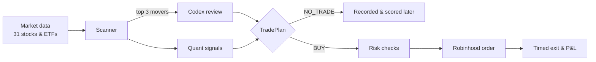

# TradeAgent

**English** | [简体中文](README.zh-CN.md)

**An AI analyst picks the trade. Plain, tested Python places it.**

TradeAgent scans US stocks and ETFs, asks a coding agent (Codex) to review the most
unusual moves, and trades the survivors on Robinhood through the official agentic
trading API, with sizing limits and an automatic exit. Every forecast is written down
*before* the market answers and scored against a random pick and SPY, so you find out
whether the AI is actually adding anything.

[](https://github.com/danielye0010/TradeAgent/actions/workflows/ci.yml)


[](LICENSE)

[Try it](#try-it-in-two-minutes) · [Why not something else?](#why-not-use-something-that-already-exists) · [Connect Robinhood](#connect-robinhood) · [Everyday use](#everyday-use) · [What protects your money](#what-protects-your-money) · [Results so far](#results-so-far)

> **Read this first.** TradeAgent is a beta tool for learning whether an AI can pick
> short-term trades. It has **not** shown that it can make money: no strategy has a
> proven edge yet. Use amounts you would be happy to lose. Not financial advice.

## How it works



The split is the whole point: **the model decides what is worth a look; it never touches
the broker.** Sizing, limits, order placement, exits and reconciliation are ordinary
Python that behaves the same way every time and is covered by 1,000+ offline tests.

## Why not use something that already exists?

TradeAgent reuses what already works: Robinhood's [official agentic trading
MCP](https://robinhood.com/us/en/support/articles/agentic-trading-overview/) for data and
orders, [Codex](https://github.com/openai/codex) for the analysis (on your ChatGPT plan,
no per-token API bill), and standard libraries for market calendars. What it adds is the
piece none of the alternatives below provide: a guarded path from an AI suggestion to a
real order and back out, plus an honest record of whether the suggestions were any good.

| Alternative | Good at | Missing for this job |
| --- | --- | --- |
| Connect ChatGPT, Claude or Codex straight to the Robinhood MCP and ask it to trade | One-off orders in plain English | The model itself holds the order tools: it can misread a quote, resubmit after a timeout or never sell. Limits live in the prompt, not in code, and nobody scores its calls afterwards. |
| "AI hedge fund" projects such as [ai-hedge-fund](https://github.com/virattt/ai-hedge-fund) and [TradingAgents](https://github.com/TauricResearch/TradingAgents) | Exploring multi-agent market analysis | They simulate trades rather than placing them, and need paid per-token LLM API keys. |
| Unofficial Robinhood libraries such as [robin_stocks](https://pypi.org/project/robin-stocks/) | Scripting your own account | They wrap Robinhood's private API and log in with your username, password and MFA. TradeAgent uses the official API and a browser sign-in, so it never sees your password. |
| Backtesting frameworks (backtrader, vectorbt, LEAN, ...) | Testing ideas on years of history | They answer "what would have worked?", which is easy to overfit. TradeAgent answers "is it working now?" by freezing forecasts before the outcome exists. |

**When TradeAgent is the wrong tool:** you want years of historical backtests, crypto or
another broker, long-term investing, or a strategy that is already known to be profitable.

## Try it in two minutes

Needs Linux or WSL2 on Windows, and Python 3.12+. No accounts.

```bash
git clone https://github.com/danielye0010/TradeAgent.git
cd TradeAgent
python3 -m venv .venv && source .venv/bin/activate
pip install -e .

tradeagent                      # list of commands, grouped by what you want to do
tradeagent demo --demo-dir work/demo
tradeagent run-once --paper --state-dir work/paper
```

Each command prints a full JSON record, and a short summary when you run it in a
terminal:

```text
Demo passed: synthetic data only, 0 broker calls.
  150 forecasts recorded and scored, 15 learning runs, 5 challenger strategies created.
  These numbers exercise the machinery; they are not evidence of profit.

Paper round trip: COMPLETED (simulated broker, no real orders)
  buy  2 IWM @ 10.01 (filled)
  sell 2 IWM @ 9.99 (filled)
  Realized P&L: -$0.04
```

`tradeagent inspect --state-dir work/demo` shows what the demo lab learned. Keep state
directories on a local Linux disk (ext4, btrfs or xfs); TradeAgent refuses network shares
and Windows mounts such as `/mnt/c` because SQLite locking is unreliable there.

## Connect Robinhood

You need a Robinhood individual investing account in good standing. When you approve
TradeAgent, Robinhood walks you through opening a separate **agentic account**; that is
the only account TradeAgent can trade in. Put in it only what you are willing to risk.

```bash
tradeagent login        # opens Robinhood in your browser; approve TradeAgent
tradeagent live-check   # read-only: account, permissions, quotes. Never places orders.
```

`login` uses the standard OAuth sign-in Robinhood offers to AI apps. Your password stays
with Robinhood; TradeAgent keeps only a refresh token, readable by you alone, in
`~/.config/tradeagent/`. It also creates `~/.config/tradeagent/tradeagent.toml`, the one
file that controls real trading:

```toml
[live]
symbols = ["QQQ", "IWM"]   # the only symbols TradeAgent is allowed to buy
max_notional = "25"        # hard dollar ceiling for any single entry

[entry]
dollar_amount = "5"        # each live entry spends exactly this much

[exit]
hold_seconds = 3600        # sell automatically after one hour
```

On a machine without a browser, use `tradeagent login --paste` and paste back the address
Robinhood redirects you to. `tradeagent logout` forgets the session.

## Everyday use

There are three ways to use TradeAgent. Only the last two can spend real money, and only
when you start them yourself.

### 1. Ask the analyst (Codex)

Install the [Codex CLI](https://github.com/openai/codex), open it in the TradeAgent folder
and talk to the `trade-opportunity-analyst` skill:

| Mode | Say this | What happens |
| --- | --- | --- |
| **Research** | `$trade-opportunity-analyst Analyze today's market and generate a TradePlan.` | Scans, reads news for the top candidates, explains its reasoning. No orders. |
| **Live** | `$trade-opportunity-analyst LIVE: analyze today's market, show the purchase plan, execute if eligible, and report P&L.` | Buys only when a strategy has passed its evidence threshold for that setup. So far none has, so expect `NO_TRADE`. |
| **Experimental live** | `$trade-opportunity-analyst EXPERIMENTAL LIVE: trade today's strongest quant signal with my $5 setting.` | At most one $5 position a day on the best quant signal, then the timed exit. For learning from real fills, recorded separately. |

The same steps also run by hand: `tradeagent opportunity scan`, `decide`, `show` and
`compare`. See the [opportunity workflow](docs/opportunity-workflow.md).

### 2. Let the daily autopilot paper-trade

A systemd timer runs the research loop every trading day with no chat window and no real
orders. It needs `tradeagent login`, the Codex CLI signed in with your ChatGPT account,
and on WSL2 [systemd enabled](https://learn.microsoft.com/windows/wsl/systemd):

```bash
python scripts/install_shadow.py --daily \
  --python "$PWD/.venv/bin/python" \
  --state-dir "$HOME/tradeagent-research/daily"
```

At 10:00 ET it scans the market and asks Codex to rank the top three candidates, then
records four competing picks with identical entry, exit and costs:

| Arm | How it picks |
| --- | --- |
| **Quant only** | Strongest quantitative signal |
| **Codex only** | Codex's top-ranked *long* |
| **Quant + Codex** | Best name both agree on |
| **Random** | A seeded coin flip among the same candidates, or cash |

After each run, `daily-report.md` in the state directory shows every arm's P&L after
costs and its excess over SPY for the same hour. If Codex cannot beat **Random**, it is not
helping. A second protocol, `--protocol daily-news-v2`, asks Codex the same question with
and without live web search, which measures exactly what reading the news is worth.
Details: [daily autopilot](docs/prospective-shadow.md).

### 3. Place one trade yourself

```bash
tradeagent run-once --live   # one entry from your config, then the automatic exit
tradeagent status            # read-only view of the current run
tradeagent recover           # finish an interrupted run; only ever sells
```

This is the execution path without any AI involved, useful for checking that orders,
fills and exits work on your account before trusting the analyst. Full reference:
[live execution](docs/one-shot.md).

## What protects your money

AI output is unpredictable; the code between it and your account is not. Before every
order the engine checks, and refuses to trade if anything is off:

- **Hard caps:** your dollar amount, a per-entry ceiling, position and exposure limits, a
  cash reserve and a daily loss limit. Nothing is resized upward; there is no leverage,
  no short selling and no margin.
- **Allowlist:** only the symbols in your config, only in regular market hours.
- **Fresh data:** account, quotes, spread and depth must be seconds old and agree with
  each other, or the run halts.
- **No double orders:** every order is journaled with a unique ID *before* it is sent and
  is never blindly retried, so a timeout cannot turn one buy into two.
- **A built-in way out:** the exit is part of the same run, due after your hold time or
  shortly before the close. If your computer sleeps or the network drops,
  `tradeagent recover` resumes the run and can only sell. Create a file named `KILL` in
  the state directory (`~/.local/state/tradeagent/live`) to stop buying and exit now.
  No software can promise a fill in a halted or illiquid market, which is one more
  reason to keep amounts small.

Robinhood's own approval settings still apply on top of this.

## Results so far

No strategy has shown a repeatable edge after costs. The best historical rule made four
profitable trades in its holdout period, too few to mean anything, and its gains look
like ordinary market exposure rather than skill
([alpha findings](docs/alpha-findings.md)). The daily autopilot started collecting
forward evidence in October 2026. Telling a real edge of a few hundredths of a percent per
trade from luck takes on the order of a year of daily observations, which is why every
pick is recorded and compared with Random and SPY rather than judged by a good week.

## Experimental research

These run alongside the main loop in their own state directories, place no orders and
make no profit claims:

| Protocol | Question | Status |
| --- | --- | --- |
| `daily-four-arm-v1` | Does Codex beat quant signals and a random pick? | Collecting daily |
| `daily-news-v2` | Does live news search improve Codex's picks? | Collecting daily |
| `continuous-quant-v5` | Does intraday momentum survive 1–10 minute decision delays? | [Docs](docs/continuous-v5.md) |
| `event-driven-v6` | Does Codex reading SEC filings beat a mechanical baseline? | [Docs](docs/event-driven-v6.md) |
| `daily-bidirectional-v3`, `daily-call-put-v4` | Do bearish forecasts work as put options? | Waiting on Robinhood option quote access; timers stay disabled |

## Project layout

```text
.agents/skills/trade-opportunity-analyst/   the Codex skill
src/tradeagent/
  research/          scanner, signals, TradePlans, outcome scoring
  prospective/       daily autopilot and market-data providers
  oneshot.py         live entry, exit and recovery engine
  risk.py            position, exposure and cash limits
  robinhood_login.py browser sign-in and token helper
scripts/             systemd installers and release checks
docs/                design notes and operating guides
```

More reading: [architecture](docs/architecture.md), [research protocol](docs/research-protocol.md),
[changelog](CHANGELOG.md), [release workflow](docs/releasing.md).

## Development

```bash
pip install -e ".[dev]"
pytest -q
ruff check src tests scripts && ruff format --check src tests scripts
```

The tests use synthetic markets, a mock broker and a fake OAuth server, so they run
offline in about two minutes. CI covers Python 3.12 through 3.14 and smoke-tests the
built wheel. See [CONTRIBUTING.md](CONTRIBUTING.md).

## License

[Apache 2.0](LICENSE), with some vendored MIT components ([details](THIRD_PARTY.md)).
TradeAgent is an independent project, not affiliated with Robinhood Markets, Inc. or
OpenAI. Trading involves risk of loss, including loss of your entire investment.
