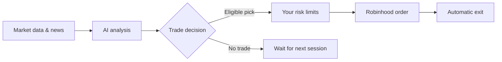

# TradeAgent

**English** | [简体中文](README.zh-CN.md)

**An AI agent that analyzes the market and trades for you on Robinhood.**

[](https://github.com/danielye0010/TradeAgent/actions/workflows/ci.yml)
[](https://pypi.org/project/tradeagent/)
[](LICENSE)

TradeAgent uses Codex to review market moves and news, choose a US stock or ETF, and
explain its reasoning. Enable automatic trading to act on the AI's daily pick through
Robinhood's official agentic trading API, within the limits you set.

- **Automate your daily trade.** Once configured, the agent analyzes, buys eligible
  picks and manages the scheduled exit. It skips days when there is no eligible trade.
- **Stay in control.** Choose allowed symbols, set the trade amount and enforce risk limits.
  Automatic trading currently supports $1–$5 per entry, at most once per trading day,
  with a one-hour hold.
- **See what the agent is doing.** A local dashboard shows account value, profit and
  loss, trade history, and the AI's choices and reasoning.
- **Use your existing accounts.** Connect Codex with your ChatGPT sign-in and Robinhood
  through its official browser login.



## Get started

You need Linux or WSL2, Python 3.12+, a ChatGPT account with Codex access, and an
eligible Robinhood agentic account. Run the commands below as the same Linux user.
Keep the checkout and trading state on the local Linux filesystem.

```bash
git clone https://github.com/danielye0010/TradeAgent.git
cd TradeAgent
python3 -m venv .venv
source .venv/bin/activate
pip install .
curl -fsSL https://chatgpt.com/codex/install.sh | sh
```

Open a new terminal, return to the checkout and activate `.venv`, then connect your accounts:

```bash
codex login              # ChatGPT browser sign-in
codex login status
tradeagent login         # Robinhood browser sign-in; creates your configuration
tradeagent doctor        # check your local setup
tradeagent live-check    # check account access and quotes without placing orders
tradeagent dashboard     # open your local dashboard
```

TradeAgent calls Codex in the background; you do not need to keep a Codex window open.
Installing the package or opening the dashboard does not enable trading.
See the [setup guide](docs/getting-started.md) for help.

## Turn on automatic trading

Edit the existing `~/.config/tradeagent/tradeagent.toml` created by login. Choose your
allowed symbols and amount, enable LIVE, and set the one-hour exit required by autotrade.
Keep the other generated settings:

```toml
[live]
enabled = true
symbols = ["QQQ", "IWM"]   # only these symbols may be bought
max_notional = "25"        # per-entry ceiling in dollars

[entry]
order_type = "market"
dollar_amount = "5"        # autotrade accepts $1–$5

[exit]
order_type = "market"
hold_seconds = 3600
```

From the checkout, with `.venv` active, install the daily AI decision service, then
enable its real-money trading timer:

```bash
python scripts/install_shadow.py --daily --protocol daily-news-v2 \
  --python "$PWD/.venv/bin/python" \
  --state-dir "$HOME/.local/state/tradeagent/daily-decisions"
tradeagent autotrade install --enable
systemctl --user list-timers tradeagent-daily-news.timer tradeagent-autotrade.timer
```

The first service generates decisions without placing orders; autotrade follows its
AI news analyst's pick. Trading starts at 10:30 New York time on trading days, subject
to a valid decision, your symbol list, account readiness and risk checks. Picks outside
your list are skipped. Missed entry windows are skipped too.

This requires systemd user services and an awake computer with Linux or WSL running
through the trade and exit. The service must be able to find `codex` in `~/.local/bin`,
`/usr/local/bin`, `/usr/bin` or `/bin`.

To stop future scheduled runs:

```bash
tradeagent autotrade uninstall
```

Use `tradeagent status` to check an existing trade and `tradeagent recover` to resume
its exit if interrupted. See [automatic trading](docs/autotrade.md) for account funding,
configuration and recovery details.

## Ask the agent

Run `codex` from the checkout and ask for an analysis:

```text
$trade-opportunity-analyst Analyze today's market and generate a TradePlan.
```

The agent explains the candidates and its proposed trade without placing an order.
For an owner-initiated trade using your configured entry, use
`tradeagent run-once --live`. See [manual trading and recovery](docs/one-shot.md).

## Trading controls

The AI selects a trade; the execution engine enforces your settings. Orders require
fresh data, an allowed symbol, regular market hours, and sufficient cash within your
position, exposure and loss limits. TradeAgent does not use leverage or short selling.
Orders are recorded before submission and are never blindly retried. A `KILL` file in
the configured live state directory blocks new buys and requests exit management.

Automatic exits require the process and broker connection to be available. After an
interruption, check the position and use `tradeagent recover`. AI decisions can lose money.

## Documentation

[Setup](docs/getting-started.md) · [Automatic trading](docs/autotrade.md) ·
[Dashboard](docs/dashboard.md) · [Manual trading](docs/one-shot.md) ·
[Architecture](docs/architecture.md) · [Contributing](CONTRIBUTING.md) · [Changelog](CHANGELOG.md)

## License

[Apache 2.0](LICENSE), with some vendored MIT components ([details](THIRD_PARTY.md)).
