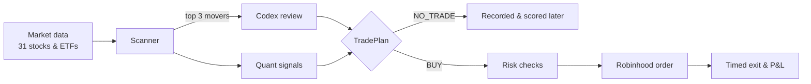

# TradeAgent

**English** | [简体中文](https://github.com/danielye0010/TradeAgent/blob/main/README.zh-CN.md)

**An AI analyst picks the trade. Plain, tested Python places it.**

[](https://github.com/danielye0010/TradeAgent/actions/workflows/ci.yml)
[](https://pypi.org/project/tradeagent/)

[](https://github.com/danielye0010/TradeAgent/blob/main/LICENSE)

> **TL;DR**
> - **What it is:** an AI trading agent for US stocks and ETFs on Robinhood. Every morning
>   Codex reviews the market's most unusual movers; deterministic Python sizes, places and
>   exits the trade through Robinhood's official agentic trading API.
> - **What's different:** the model never touches the broker, and every forecast is frozen
>   before the market answers, then scored against quant signals, a random pick and SPY.
> - **What you get:** a daily autopilot that paper-trades every session on its own,
>   one-command live trades with hard caps and an automatic exit, an optional small live
>   trade every trading day on a timer, and a local dashboard
>   that shows what is running, what the AI picked and why, and how each approach scores.
>   Options trading (calls and puts) is coming soon.
> - **Start:** follow [Quick start](#quick-start) to install and sign in to Codex and Robinhood.


<sub>The dashboard on real Paper data, Oct 14–16, 2026.</sub>

## How it works



The model decides what is worth a look. Sizing, limits, orders, exits and reconciliation
are ordinary Python, covered by 1,000+ offline tests.

## Why TradeAgent

Built on what already works: Robinhood's [official agentic trading MCP](https://robinhood.com/us/en/support/articles/agentic-trading-overview/)
for data and orders, and [Codex](https://github.com/openai/codex) for analysis on your
ChatGPT plan, with no per-token API bill.

| Instead of | TradeAgent gives you |
| --- | --- |
| An LLM wired straight to the broker | Order tools the model can't reach: limits enforced in code, every order journaled so a timeout can't double it, a scheduled exit, and a score for every call. |
| "AI hedge fund" repos ([ai-hedge-fund](https://github.com/virattt/ai-hedge-fund), [TradingAgents](https://github.com/TauricResearch/TradingAgents)) | Real orders on a real account, analysis on your ChatGPT plan instead of API keys. |
| Unofficial Robinhood libraries ([robin_stocks](https://pypi.org/project/robin-stocks/)) | The official API and a browser sign-in; your password never leaves Robinhood. |
| Backtesting frameworks (backtrader, vectorbt, LEAN) | Live evidence: forecasts frozen before the outcome exists, so nothing is fitted after the fact. |

## Real-market results

Live market data, Paper trading: Codex picked **TLT** on Oct 14, 2026 (**+0.14%** net)
and **CRM** on Oct 15, 2026 (**+0.99%** net) in the daily news test.

## Quick start

Linux or WSL2, Python 3.12+. Run these commands as the same Linux user, inside WSL
if you use Windows. Keep state under your Linux home, on ext4/btrfs/xfs, not `/mnt/c`
or a network share. If pipx uses an older Python, add `--python python3.12` to its
install command.

```bash
pipx install tradeagent   # Ubuntu/WSL: sudo apt install pipx first
pipx ensurepath
curl -fsSL https://chatgpt.com/codex/install.sh | sh  # official Codex CLI installer
```

Open a new terminal, then sign in to the two services separately:

```bash
codex login              # ChatGPT browser sign-in; requires Codex access
codex login status       # verify Codex sign-in; tradeagent doctor only detects the CLI
tradeagent login         # Robinhood browser sign-in; creates the starter TOML
tradeagent doctor        # offline setup checklist
tradeagent live-check    # read-only account, permissions and quotes check
tradeagent dashboard     # opens the local dashboard; Ctrl+C stops it
```

Codex CLI is required for the AI analyst and Autopilot. TradeAgent starts
[`codex exec`](https://learn.chatgpt.com/docs/non-interactive-mode) automatically;
you do not need to keep a Codex window open. If the CLI or its login is missing,
AI assessments are unavailable; the dashboard and manual trading do not require Codex.
See the [official installation guide](https://learn.chatgpt.com/docs/codex/cli) for other install methods.

`tradeagent login` uses Robinhood OAuth for its separate **agentic account**.
`live-check` can report NOT READY outside market hours; you can still view the dashboard.

`tradeagent.toml` is the one file that controls real money:

```toml
[live]
symbols = ["QQQ", "IWM"]   # the only symbols it may buy
max_notional = "25"        # hard ceiling per entry, in dollars
[entry]
dollar_amount = "5"        # each entry spends exactly this
[exit]
hold_seconds = 3600        # sell automatically after an hour
```

## Daily use

**Dashboard.** `tradeagent dashboard` finds the installed timers and the live run on its
own. Today's session as a timeline, every frozen decision with Codex's reasoning, per-arm
results against SPY and Random, and every trade with its fills. Local and read-only.
[More](https://github.com/danielye0010/TradeAgent/blob/main/docs/dashboard.md)


**Daily autopilot (Paper only).** Install this separately: neither pipx nor the dashboard starts
a timer. It needs a running systemd user manager, an awake machine and, on Windows,
WSL kept running. From a clone of this repo under your Linux home:

```bash
git clone https://github.com/danielye0010/TradeAgent.git && cd TradeAgent
python3 -m venv .venv && source .venv/bin/activate && pip install -e .
python scripts/install_shadow.py --daily --python "$PWD/.venv/bin/python" \
  --state-dir "$HOME/tradeagent-research/daily"
systemctl --user list-timers tradeagent-daily-research.timer
```

The timer must find `codex` in `~/.local/bin`, `/usr/local/bin`, `/usr/bin` or `/bin`;
a custom shell-only PATH is not inherited. Each research state directory belongs to one protocol.

At 10:00 ET it scans the market, has Codex rank the top three, and freezes four picks
with identical entry, exit and costs: **Quant only**, **Codex only**, **Quant + Codex** and
**Random**. Add `--protocol daily-news-v2` to also measure what reading the news is worth.
[More](https://github.com/danielye0010/TradeAgent/blob/main/docs/prospective-shadow.md)

**Ask the analyst.** Clone this repo first (or use the checkout above): pipx does not
install its `.agents/skills`. Run `codex` from that checkout and use the
`trade-opportunity-analyst` skill:

| Say | What happens |
| --- | --- |
| `$trade-opportunity-analyst Analyze today's market and generate a TradePlan.` | Scans, reads news for the top candidates, explains its reasoning. No orders. |
| `$trade-opportunity-analyst LIVE: analyze today's market, show the purchase plan, execute if eligible, and report P&L.` | Buys when a strategy clears its evidence bar for the setup; otherwise a reasoned `NO_TRADE`. |
| `$trade-opportunity-analyst EXPERIMENTAL LIVE: trade today's strongest quant signal with my $5 setting.` | Up to one $5 position a day on the best quant signal, then the timed exit. |

**One trade by hand.** `tradeagent run-once --live` buys per the TOML and exits on its own;
`status` shows the run, `recover` finishes an interrupted one (it only sells).
[More](https://github.com/danielye0010/TradeAgent/blob/main/docs/one-shot.md)

**A live trade every day.** `tradeagent autotrade install --enable` adds a weekday timer
(10:15 New York time). Each morning it scans, and when the quant signal is eligible it
buys your `dollar_amount` ($1–$5) and sells after `hold_seconds`; otherwise it sits the
day out. One entry per day, every risk limit and `KILL` still apply.
[More](https://github.com/danielye0010/TradeAgent/blob/main/docs/autotrade.md)

## Built-in safety

The AI suggests; code decides. Before every order:

- **Hard caps:** dollar amount, per-entry ceiling, position and exposure limits, cash reserve,
  daily loss limit. No leverage, shorting or margin.
- **Allowlist:** configured symbols only, regular hours only.
- **Fresh data:** account, quote, spread and depth seconds old and consistent.
- **Exactly once:** each order is journaled with a unique ID before it is sent and never
  blindly retried.
- **Built-in exit:** part of the same run. `recover` picks it back up after a sleep or
  network drop; a `KILL` file in `~/.local/state/tradeagent/live` stops buying and starts
  the exit.

Robinhood API updates are checked tool by tool: additive changes keep working, anything
that could change what an order means pauses trading with a clear message.

## Research lab

Running side by side, each in its own state directory: `daily-four-arm-v1` (Codex vs quant
vs random, collecting daily), `daily-news-v2` (does reading the news help, collecting daily),
[`continuous-quant-v5`](https://github.com/danielye0010/TradeAgent/blob/main/docs/continuous-v5.md)
(does intraday momentum survive decision delays),
[`event-driven-v6`](https://github.com/danielye0010/TradeAgent/blob/main/docs/event-driven-v6.md)
(Codex reading SEC filings).

**Coming soon: options.** Calls for bullish picks and puts for bearish ones, with the same
caps, frozen forecasts and automatic exit. The selection and scoring are built (`v3`, `v4`)
and switch on as Robinhood rolls out option market data to agentic accounts.

## Docs and development

[Dashboard](https://github.com/danielye0010/TradeAgent/blob/main/docs/dashboard.md) ·
[Autotrade](https://github.com/danielye0010/TradeAgent/blob/main/docs/autotrade.md) ·
[Architecture](https://github.com/danielye0010/TradeAgent/blob/main/docs/architecture.md) ·
[Research protocol](https://github.com/danielye0010/TradeAgent/blob/main/docs/research-protocol.md) ·
[Getting started in depth](https://github.com/danielye0010/TradeAgent/blob/main/docs/getting-started.md) ·
[Changelog](https://github.com/danielye0010/TradeAgent/blob/main/CHANGELOG.md)

```bash
pip install -e ".[dev]" && pytest -q && ruff check src tests scripts
```

Tests run offline in about two minutes on synthetic markets, a mock broker and a fake OAuth
server. See [CONTRIBUTING.md](https://github.com/danielye0010/TradeAgent/blob/main/CONTRIBUTING.md).

## License

[Apache 2.0](https://github.com/danielye0010/TradeAgent/blob/main/LICENSE), with some vendored MIT components ([details](https://github.com/danielye0010/TradeAgent/blob/main/THIRD_PARTY.md)).
