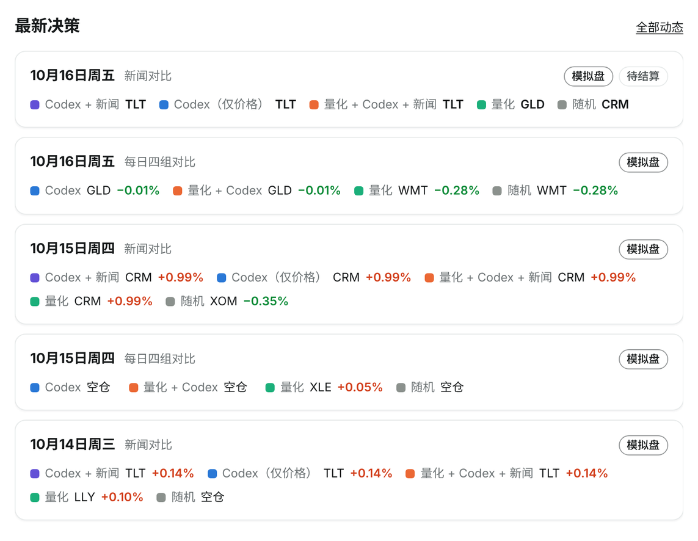
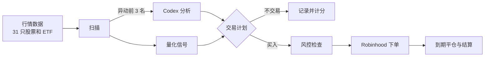
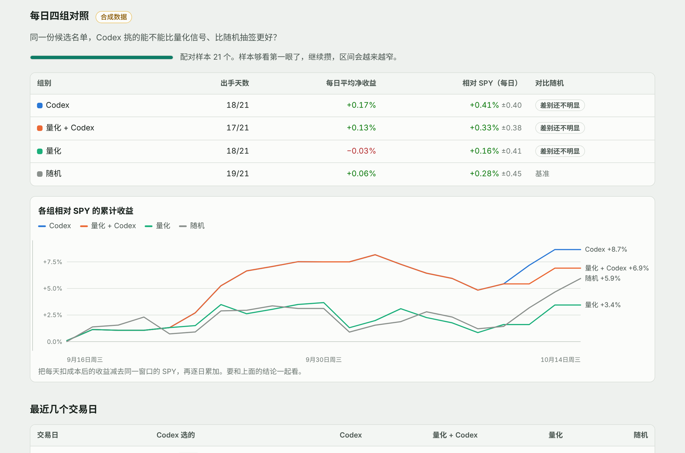

# TradeAgent

[English](README.md) | **简体中文**

**AI 选股，Python 下单。**

[](https://github.com/danielye0010/TradeAgent/actions/workflows/ci.yml)
[](https://pypi.org/project/tradeagent/)

[](LICENSE)

> **TL;DR**
> - **是什么**：基于 Robinhood 的美股 / ETF 交易 Agent。每个交易日上午，Codex 从盘中异动最大的标的里挑出值得做的，
>   仓位计算、下单和到期平仓由经过测试的 Python 代码完成，接入 Robinhood 官方的 Agent 交易接口。
> - **核心设计**：模型不直接接触券商接口；每次预测都在结果揭晓前锁定，之后与量化信号、随机选股和 SPY 一起计分，
>   AI 到底有没有用，看数据。
> - **主要功能**：Autopilot 每个交易日自动跑一轮模拟盘；一条命令完成实盘交易，带金额上限和自动平仓；
>   也可以开启定时任务，用小额实盘每天跟着 AI 的选择下单；
>   本地 Dashboard 像交易软件一样展示账户价值和盈亏、今天的交易、AI 的选择和理由，以及各策略的表现。期权（Call/Put）交易即将上线。
> - **快速开始**：按[下面的步骤](#快速开始)安装，并分别登录 Codex 和 Robinhood。

<p align="center">
  
  <br><sub>Dashboard 展示的真实模拟盘数据，2026 年 10 月 14–16 日。</sub>
</p>

## 工作原理



模型只负责判断哪些标的值得关注。仓位、限额、下单、平仓和对账都由普通 Python 代码完成，有 1000 多个离线测试覆盖。

## 为什么选 TradeAgent

数据和下单直接用 Robinhood
[官方 Agent 交易 MCP](https://robinhood.com/us/en/support/articles/agentic-trading-overview/)，
分析用 [Codex](https://github.com/openai/codex)，走 ChatGPT 订阅，不按 token 计费。现成能用的都直接接入，
TradeAgent 专注补上其余方案缺的部分：

| 常见方案 | TradeAgent 的不同 |
| --- | --- |
| 让大模型直接调用券商接口下单 | 模型拿不到下单工具。限额写死在代码里，每笔订单先记录再发送，超时也不会重复下单；平仓时间提前安排好，每次判断都会计分。 |
| “AI 对冲基金”类项目（[ai-hedge-fund](https://github.com/virattt/ai-hedge-fund)、[TradingAgents](https://github.com/TauricResearch/TradingAgents)） | 在真实账户里真实下单；分析走 ChatGPT 订阅，不需要另配 API key。 |
| 非官方 Robinhood 库（[robin_stocks](https://pypi.org/project/robin-stocks/)） | 使用官方接口和浏览器登录，密码只留在 Robinhood。 |
| 回测框架（backtrader、vectorbt、LEAN） | 实时验证：预测在结果出现前就已锁定，不存在事后拟合。 |

## 真实行情下的运行结果

真实行情、模拟盘交易：在每日新闻对比中，Codex 于 2026 年 10 月 14 日选中 **TLT**，净收益 **+0.14%**；
10 月 15 日选中 **CRM**，净收益 **+0.99%**。

## 快速开始

环境要求：Linux 或 WSL2，Python 3.12+。以下命令用同一个 Linux 用户执行，Windows 用户在 WSL 中操作。
数据保存在 Linux 主目录下的 ext4/btrfs/xfs 本地磁盘，不要放在 `/mnt/c` 或网络盘。
如果 pipx 默认用了旧版 Python，安装时加上 `--python python3.12`。

```bash
pipx install tradeagent   # Ubuntu/WSL 需先 sudo apt install pipx
pipx ensurepath
curl -fsSL https://chatgpt.com/codex/install.sh | sh  # Codex CLI 官方安装脚本
```

重开终端，然后分别登录两个服务：

```bash
codex login              # ChatGPT 浏览器登录，账户需有 Codex 使用权限
codex login status       # 确认 Codex 已登录；tradeagent doctor 只检查 CLI 是否存在
tradeagent login         # Robinhood 浏览器登录，同时生成初始 TOML 配置
tradeagent doctor        # 离线检查环境
tradeagent live-check    # 只读检查账户、权限和报价，不下单
tradeagent dashboard     # 打开本地 Dashboard，Ctrl+C 停止
```

AI 分析和 Autopilot 需要 Codex CLI。TradeAgent 会自动在后台调用
[`codex exec`](https://learn.chatgpt.com/docs/non-interactive-mode)，**不需要一直开着 Codex 窗口**。
未安装或未登录时，AI 分析会标记为不可用；查看 Dashboard 和手动交易不依赖 Codex。
其他安装方式见 [Codex 官方指南](https://learn.chatgpt.com/docs/codex/cli)。

`tradeagent login` 通过 Robinhood OAuth 连接独立的 **Agent 账户**。
非交易时段 `live-check` 可能提示 NOT READY，不影响查看 Dashboard。

实盘只认 `tradeagent.toml` 这一个配置文件：

```toml
[live]
symbols = ["QQQ", "IWM"]   # 允许买入的标的
max_notional = "25"        # 单笔金额上限（美元）
[entry]
dollar_amount = "5"        # 每次买入的金额
[exit]
hold_seconds = 3600        # 持有一小时后自动卖出
```

## 日常使用

**Dashboard。** `tradeagent dashboard` 打开就是账户页：账户价值、累计盈亏、收益曲线，今天买了什么、
几点卖，一眼看清。每个锁定的决策都能点开查看 Codex 的分析，各组和随机选股的对比、每笔交易的明细也都在这里。
默认红涨绿跌，可一键切换。自动找到已安装的定时任务和实盘记录，仅在本机运行，只读。[详细说明](docs/dashboard.md)

<p align="center">
  
</p>

**Autopilot。** 需要单独安装定时任务，pipx 安装和打开 Dashboard 都不会自动开启。只跑模拟盘，
需要 systemd 用户服务可用、电脑保持运行；Windows 用户还需保持 WSL 运行。在 Linux 主目录下克隆仓库：

```bash
git clone https://github.com/danielye0010/TradeAgent.git && cd TradeAgent
python3 -m venv .venv && source .venv/bin/activate && pip install -e .
python scripts/install_shadow.py --daily --python "$PWD/.venv/bin/python" \
  --state-dir "$HOME/tradeagent-research/daily"
systemctl --user list-timers tradeagent-daily-research.timer
```

定时任务需要在 `~/.local/bin`、`/usr/local/bin`、`/usr/bin` 或 `/bin` 中找到 `codex`，
不会继承仅在终端里设置的 PATH。每个研究协议需使用独立的数据目录。

每天美东 10:00 扫描市场，由 Codex 对前三名排序，然后锁定四组选择，入场、出场和成本完全一致：
**纯量化**、**纯 Codex**、**量化 + Codex**、**随机**。加上 `--protocol daily-news-v2` 还能测出读新闻能带来多少提升。
[详细说明](docs/prospective-shadow.md)

**直接问 Codex。** 先克隆仓库，或使用上面的已有目录；pipx 不会安装仓库里的 `.agents/skills`。
在仓库目录运行 `codex`，调用 `trade-opportunity-analyst` skill，按下表原样输入：

| 指令 | 效果 |
| --- | --- |
| `$trade-opportunity-analyst Analyze today's market and generate a TradePlan.` | 扫描市场，阅读候选标的的新闻，给出分析理由，不下单。 |
| `$trade-opportunity-analyst LIVE: analyze today's market, show the purchase plan, execute if eligible, and report P&L.` | 有策略在当前情形下达到证据门槛时买入，否则返回附带理由的 `NO_TRADE`。 |
| `$trade-opportunity-analyst EXPERIMENTAL LIVE: trade today's strongest quant signal with my $5 setting.` | 每天最多按最强的量化信号买入一笔 5 美元，到期自动平仓。 |

**手动下一单。** `tradeagent run-once --live` 按配置买入并自动平仓；`status` 查看进度，
`recover` 接着完成被中断的交易（只卖不买）。[详细说明](docs/one-shot.md)

**实盘跟单 AI。** `tradeagent autotrade install --enable` 装好工作日定时任务，跟随 `daily-news-v2`
里读新闻的 Codex 组：同一个冻结选择、同一个入场时间、同样持有一小时，金额按 `dollar_amount`（1–5 美元）。
它选现金就不买。每天最多一笔，所有风控和 `KILL` 照常生效。[详细说明](docs/autotrade.md)

## 内置安全机制

AI 给建议，代码做决定。每次下单前都会检查：

- **金额上限**：单笔金额、单笔上限、持仓与敞口、现金保留、每日亏损上限。不加杠杆，不做空，不融资。
- **标的白名单**：只买配置里的标的，只在常规交易时段交易。
- **数据新鲜度**：账户、报价、价差和盘口必须是几秒内的数据，且彼此一致。
- **不重复下单**：订单发出前先带唯一 ID 写入日志，不会盲目重试。
- **自动平仓**：平仓是同一次运行的一部分。电脑休眠或断网后，`recover` 会接着完成；在
  `~/.local/state/tradeagent/live` 下创建 `KILL` 文件，会立即停止买入并开始平仓。

Robinhood 接口更新时会逐个工具检查：新增字段不影响运行；可能改变订单含义的变化会暂停交易，并给出明确原因。

## 研究实验

以下实验同时运行，各自使用独立的数据目录：`daily-four-arm-v1`（Codex、量化与随机选股对比，每天积累数据）、
`daily-news-v2`（读新闻是否有帮助，每天积累数据）、[`continuous-quant-v5`](docs/continuous-v5.md)
（日内动量信号能否承受决策延迟）、[`event-driven-v6`](docs/event-driven-v6.md)（让 Codex 读 SEC 公告）。

**期权即将上线。** 看多买 Call，看空买 Put，同样有金额上限、预测锁定和自动平仓。选约和计分逻辑已经完成（`v3`、`v4`），
Robinhood 向 Agent 账户开放期权行情后即可启用。

## 文档与开发

[Dashboard](docs/dashboard.md) · [实盘跟单](docs/autotrade.md) · [架构](docs/architecture.md) · [研究协议](docs/research-protocol.md) ·
[详细上手指南](docs/getting-started.md) · [更新日志](CHANGELOG.md)（文档为英文）

```bash
pip install -e ".[dev]" && pytest -q && ruff check src tests scripts
```

测试使用合成行情、模拟券商和模拟 OAuth 服务器，可离线运行，约两分钟跑完。参与贡献请看 [CONTRIBUTING.md](CONTRIBUTING.md)。

## 许可证

[Apache 2.0](LICENSE)，部分内置组件采用 MIT 许可（[详情](THIRD_PARTY.md)）。
