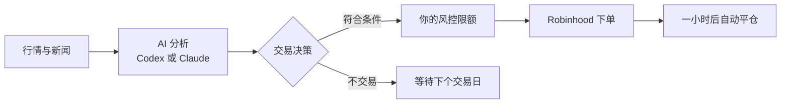

# TradeAgent

[English](README.md) | **简体中文**

**属于你自己的 AI 交易代理，每一笔都公开。**

[](https://github.com/danielye0010/TradeAgent/actions/workflows/ci.yml)
[](https://pypi.org/project/tradeagent/)
[](LICENSE)

TradeAgent 是一个运行在你自己电脑上的开源 AI 交易代理。每个交易日早上，它读新闻，
选出一只美股或 ETF（或者选择空仓），并说明理由。开启自动交易后，它会在 Robinhood 上用你设定的小金额买入、
一小时后卖出，所有限额由确定性的执行引擎强制执行。

每次选择都在行情变化前锁定，并和 SPY、同一批候选中的随机选股一起计分，让你看清 AI 到底有没有用。
**[查看公开战绩 →](https://danielye0010.github.io/TradeAgent/)**

- **替你交易，但守住硬限额。** 只买你允许的标的，每笔 1–5 美元，每天一笔，一小时后卖出。
  AI 只负责选择，下单和检查都由执行引擎完成。
- **每一步都公开。** 每次选择都附带理由和新闻来源，亏钱的日子也照样记录。
- **大脑可选：GPT 或 Claude。** 默认用 Codex（GPT）；加上 Claude 后，两者对同样的股票回答同一个问题，
  你可以对比，并决定跟随谁下单。
- **不需要 API key。** 直接用你已有的 ChatGPT 和 Claude 订阅，Robinhood 用官方浏览器登录。
- **一目了然。** 本地仪表盘展示你的账户、每笔交易和每次选择。

## 一个交易日

| 美东时间 | 发生什么 |
| --- | --- |
| 10:30 | AI 查看当天异动最明显的三只候选，读新闻后选出一只，或者都不选。 |
| 约 10:36 | 如果选中的标的在你的白名单里，按你设定的金额买入。 |
| 一小时后 | 自动卖出。 |
| 随时 | 打开仪表盘查看选择、理由和结果。 |

没有符合条件的选择、错过启动时间或任何检查未通过，当天就不交易。



## 快速开始

你需要 Linux 或 WSL2、Python 3.12+、有 Codex 使用权限的 ChatGPT 账户，以及符合条件的 Robinhood Agent 账户。
Claude 可选，需要 Claude Pro、Max、Team 或 Enterprise 订阅。所有命令用同一个 Linux 用户执行，数据放在 Linux 本地文件系统。

**1. 安装**

```bash
git clone https://github.com/danielye0010/TradeAgent.git
cd TradeAgent
python3 -m venv .venv
source .venv/bin/activate
pip install .
curl -fsSL https://chatgpt.com/codex/install.sh | sh
```

**2. 连接账户。** 重开终端，回到仓库目录并激活 `.venv`：

```bash
codex login              # ChatGPT 浏览器登录
tradeagent login         # Robinhood 浏览器登录，同时生成配置文件
tradeagent doctor        # 检查环境，并告诉你还缺什么
tradeagent live-check    # 检查账户权限和报价，不下单
```

**3. 打开仪表盘**

```bash
tradeagent dashboard
```

到这里还不会交易：安装、登录和打开仪表盘都不会下单。遇到问题见[详细上手指南](docs/getting-started.md)。

## 开启自动交易

**1. 设置限额。** 编辑 `tradeagent login` 生成的 `~/.config/tradeagent/tradeagent.toml`，其他设置保持不变：

```toml
[live]
enabled = true
symbols = ["QQQ", "IWM"]   # 只允许买入这些标的
max_notional = "25"        # 单笔金额上限，单位为美元

[entry]
order_type = "market"
dollar_amount = "5"        # 每笔 1–5 美元

[exit]
order_type = "market"
hold_seconds = 3600        # 一小时后卖出
```

**2. 开启每日 AI 研究。** 它每天早上生成并记录选择，自己从不下单。

```bash
python scripts/install_shadow.py --daily --protocol daily-news-v2 \
  --python "$PWD/.venv/bin/python" \
  --state-dir "$HOME/.local/state/tradeagent/daily-decisions"
```

**3. 开始按选择下单**

```bash
tradeagent autotrade install --enable
systemctl --user list-timers tradeagent-daily-news.timer tradeagent-autotrade.timer
```

从 10:30 到大约一小时后卖出，电脑和 Linux / WSL 需要保持运行、不休眠。
定时任务会在 `~/.local/bin`、`/usr/local/bin`、`/usr/bin` 或 `/bin` 中查找 `codex`（以及 `claude`），安装程序默认就装在这里。
停止：`tradeagent autotrade uninstall`。详见[自动交易说明](docs/autotrade.md)。

## 加上 Claude（可选）

Claude 和 Codex 在同一分钟拿到同样的三只股票、同样的行情和同一个问题，
它的选择按同一个小时、同样的成本计分。仪表盘的 **GPT vs Claude** 页面逐日展示谁领先、两者多常选得一样，
以及各自的理由。它用你的 Claude 订阅运行，不用 API key。

```bash
curl -fsSL https://claude.ai/install.sh | bash
claude                              # 用 Claude 订阅登录一次
tradeagent claude doctor --probe    # 检查登录，并实际问一次 Claude
tradeagent claude install --enable  # 在每日研究旁边运行
```

在你主动选择之前，Claude 只做研究、不下单：

```bash
tradeagent autotrade install --model claude --enable   # 改为跟随 Claude 下单
tradeagent autotrade install --enable                  # 换回 Codex（默认）
```

几天的差距多半是运气；满 20 个交易日后页面才给出结论。详见 [GPT vs Claude](docs/claude.md)。

## 仪表盘

`tradeagent dashboard` 会在浏览器里打开一个本地页面。它只读取数据，从不下单。

| 页面 | 能看到什么 |
| --- | --- |
| **账户** | 账户价值和盈亏、可拖动查看的走势图、今天的交易和最近的交易。 |
| **AI 决策** | 今天的时间安排，每一次锁定的 AI 选择和理由。 |
| **GPT vs Claude** | 谁领先、多常选得一样、每天的选择和两个模型各自的理由。 |
| **研究** | 各策略相对 SPY 和随机选股的成绩。 |
| **交易记录** | 每笔交易的价格、时间和累计盈亏。 |

想让别人也能看到？`tradeagent publish install` 会在每天收盘后，把模拟盘结果（不含你的账户信息）
发布成公开网页，就像[我们的这个](https://danielye0010.github.io/TradeAgent/)。详见[公开结果页](docs/publish.md)。

## 直接问 Agent

在仓库目录运行 `codex`，输入：

```text
$trade-opportunity-analyst Analyze today's market and generate a TradePlan.
```

它会解释候选标的和它会做的交易，但不会下单。想按自己的配置主动下一笔，使用 `tradeagent run-once --live`。
详见[手动交易与恢复](docs/one-shot.md)。

## 安全

- AI 只负责选择。执行引擎落实你的设置：新鲜报价、白名单内的标的、常规交易时段，
  以及在持仓、敞口和亏损限额内的可用资金。
- 不加杠杆，不做空。订单先记录再发送，从不盲目重试。
- 紧急停止：在实盘数据目录创建 `KILL` 文件，会阻止新的买入，并让已有持仓正常平仓。
- 交易期间电脑休眠或断网：用 `tradeagent status` 查看，用 `tradeagent recover` 完成平仓。

AI 的选择也可能亏钱，请从小金额开始。

## 文档

[安装与配置](docs/getting-started.md) · [自动交易](docs/autotrade.md) ·
[Dashboard](docs/dashboard.md) · [GPT vs Claude](docs/claude.md) · [公开结果页](docs/publish.md) ·
[手动交易](docs/one-shot.md) ·
[架构](docs/architecture.md) · [参与贡献](CONTRIBUTING.md) · [更新日志](CHANGELOG.md)（详细文档为英文）

## 许可证

[Apache 2.0](LICENSE)，部分内置组件采用 MIT 许可（[详情](THIRD_PARTY.md)）。
