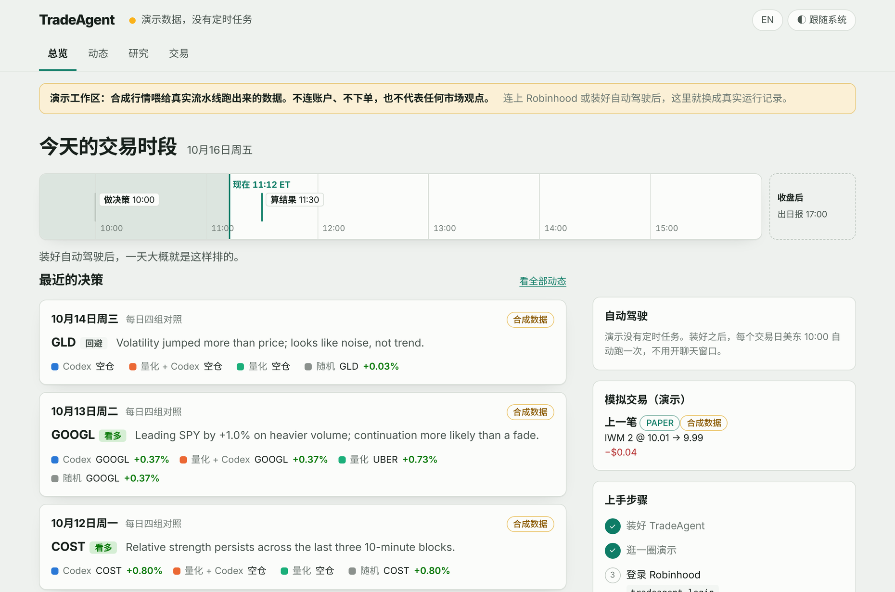
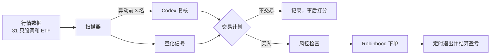

# TradeAgent

[English](README.md) | **简体中文**

**AI 负责挑票，下单交给测过的 Python。**

[](https://github.com/danielye0010/TradeAgent/actions/workflows/ci.yml)
[](https://pypi.org/project/tradeagent/)


[](LICENSE)

> **TL;DR**
> - **是什么**：跑在 Robinhood 上的美股 / ETF 交易 Agent。每天上午 Codex 把盘中最异动的几只过一遍，
>   仓位、下单、到点卖出全部交给确定性的 Python，走的是 Robinhood 官方智能体交易接口。
> - **哪里不一样**：模型碰不到券商接口；每个预测都在市场开奖前冻结，事后和量化信号、随机抽签、
>   SPY 放在一起打分，AI 有没有用，数据说了算。
> - **能干啥**：每日自动驾驶（每个交易日自己跑一轮模拟交易）；一条命令实盘下单，硬上限 + 自动平仓；
>   本地 dashboard，正在跑什么、AI 选了谁、为什么、各组成绩如何，一屏看完。
> - **怎么开始**：`pipx install tradeagent`，然后 `tradeagent dashboard --demo`，不用任何账户。



## 工作原理



模型只管“哪只值得看”。仓位、限额、下单、平仓、对账都是普通 Python，1000 多个离线测试兜底。

## 为什么选它

轮子能复用就复用：数据和下单走 Robinhood
[官方智能体交易 MCP](https://robinhood.com/us/en/support/articles/agentic-trading-overview/)，
分析用 [Codex](https://github.com/openai/codex)，吃 ChatGPT 订阅额度，不按 token 计费。

| 别的方案 | TradeAgent 多给的 |
| --- | --- |
| 大模型直连券商，让它自己下单 | 下单工具模型碰不到：限额写在代码里，每笔订单先落日志，超时也不会重复下单；平仓提前排好，每次判断都有打分。 |
| “AI 对冲基金”类项目（[ai-hedge-fund](https://github.com/virattt/ai-hedge-fund)、[TradingAgents](https://github.com/TauricResearch/TradingAgents)） | 真账户真下单，分析走 ChatGPT 订阅，不用另买 API key。 |
| 非官方 Robinhood 库（[robin_stocks](https://pypi.org/project/robin-stocks/)） | 官方接口 + 浏览器登录，密码只留在 Robinhood。 |
| 回测框架（backtrader、vectorbt、LEAN） | 实时证据：结果出来之前就冻结预测，事后没法拟合。 |

## 三分钟上手

环境：Linux 或 WSL2，Python 3.12+。

```bash
pipx install tradeagent          # Ubuntu/WSL 先 sudo apt install pipx
tradeagent dashboard --demo      # 在合成数据上看 dashboard
tradeagent run-once --paper --state-dir ~/tradeagent-paper   # 模拟券商上走一遍完整买卖
```

准备好了再连 Robinhood。`login` 走 Robinhood 给 AI 应用的标准 OAuth 登录，顺手开一个独立的
**智能体账户**，主账户完全不受影响：

```bash
tradeagent login        # 浏览器登录，生成 ~/.config/tradeagent/tradeagent.toml
tradeagent doctor       # 离线自检：哪些好了，下一步干嘛
tradeagent live-check   # 只读检查：账户、权限、报价
```

真金白银只认 `tradeagent.toml` 这一个文件：

```toml
[live]
symbols = ["QQQ", "IWM"]   # 只准买这几只
max_notional = "25"        # 单笔硬上限（美元）
[entry]
dollar_amount = "5"        # 每次买入正好花这么多
[exit]
hold_seconds = 3600        # 一小时后自动卖出
```

## 日常怎么用

**Dashboard。** `tradeagent dashboard` 会自己找到装好的定时任务和实盘记录。今天的交易时段做成时间轴，
每个冻结的决策都能点开看 Codex 的逻辑，各组相对 SPY 和随机的成绩一目了然，每笔交易的成交也都在。
只在本机跑，纯只读。[详细说明](docs/dashboard.md)


**每日自动驾驶。** systemd 定时器每个交易日跑一轮研究，不用开聊天窗口，也不下真单。先把仓库拉下来：

```bash
git clone https://github.com/danielye0010/TradeAgent.git && cd TradeAgent
python3 -m venv .venv && source .venv/bin/activate && pip install -e .
python scripts/install_shadow.py --daily --python "$PWD/.venv/bin/python" \
  --state-dir "$HOME/tradeagent-research/daily"
```

美东 10:00 扫一遍市场，让 Codex 给前三名排序，然后冻结四组选择，入场、出场、成本完全一样：
**纯量化**、**纯 Codex**、**量化 + Codex**、**随机**。加 `--protocol daily-news-v2` 还能测出
“读新闻”到底值多少。[详细说明](docs/prospective-shadow.md)

**直接问分析师。** 在仓库里打开 [Codex CLI](https://github.com/openai/codex)，用
`trade-opportunity-analyst` 技能，指令原样输入即可：

| 输入 | 会发生什么 |
| --- | --- |
| `$trade-opportunity-analyst Analyze today's market and generate a TradePlan.` | 扫市场、读候选的新闻、讲清楚理由。不下单。 |
| `$trade-opportunity-analyst LIVE: analyze today's market, show the purchase plan, execute if eligible, and report P&L.` | 某个策略在该情形下过了证据门槛才买；否则给出带理由的 `NO_TRADE`。 |
| `$trade-opportunity-analyst EXPERIMENTAL LIVE: trade today's strongest quant signal with my $5 setting.` | 每天最多按最强量化信号开一笔 5 美元，然后定时平仓。 |

**手动来一笔。** `tradeagent run-once --live` 按 TOML 买入、到点自己卖；`status` 看进度，
`recover` 接着跑完被打断的那一笔（只卖不买）。[详细说明](docs/one-shot.md)

## 内置安全机制

AI 出主意，代码拍板。每次下单前都要过：

- **硬上限**：每笔金额、单笔上限、持仓和敞口、现金保留、每日亏损上限。不加杠杆、不做空、不融资。
- **白名单**：只买配置里的标的，只在常规交易时段。
- **数据新鲜**：账户、报价、价差、盘口都得是几秒内的，而且互相对得上。
- **只下一次**：订单发出去之前先带唯一 ID 落日志，绝不盲目重试。
- **自带退路**：平仓是同一次运行的一部分。电脑睡着或断网，`recover` 接着跑；在
  `~/.local/state/tradeagent/live` 放一个 `KILL` 文件，立刻停止买入并开始平仓。

Robinhood 接口更新会逐个工具检查：只是加字段照常跑，可能改变订单含义的变化直接暂停交易并说明原因。

## 研究实验室

几条实验并行跑，各用各的状态目录：`daily-four-arm-v1`（Codex vs 量化 vs 随机，每天在攒数据）、
`daily-news-v2`（读新闻有没有用，每天在攒数据）、[`continuous-quant-v5`](docs/continuous-v5.md)
（日内动量扛不扛得住决策延迟）、[`event-driven-v6`](docs/event-driven-v6.md)（让 Codex 读 SEC 公告），
还有用看跌期权表达看空观点的 v3/v4（拿到期权报价权限后开启）。

## 文档与开发

[Dashboard](docs/dashboard.md) · [架构](docs/architecture.md) · [研究协议](docs/research-protocol.md) ·
[进阶上手](docs/getting-started.md) · [更新日志](CHANGELOG.md)（文档目前是英文）

```bash
pip install -e ".[dev]" && pytest -q && ruff check src tests scripts
```

测试用合成行情、模拟券商和模拟 OAuth 服务器，离线两分钟左右跑完。贡献方式见 [CONTRIBUTING.md](CONTRIBUTING.md)。

## 许可证

[Apache 2.0](LICENSE)，部分内置组件为 MIT（[详情](THIRD_PARTY.md)）。TradeAgent 是独立项目，
与 Robinhood Markets, Inc. 和 OpenAI 均无关联。不构成投资建议；交易有风险。
