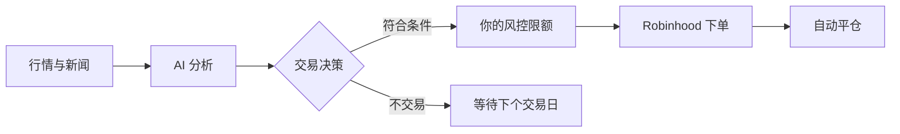

# TradeAgent

[English](README.md) | **简体中文**

**在 Robinhood 上为你分析市场、自动交易的 AI Agent。**

[](https://github.com/danielye0010/TradeAgent/actions/workflows/ci.yml)
[](https://pypi.org/project/tradeagent/)
[](LICENSE)

TradeAgent 使用 Codex 分析行情和新闻，选择美股或 ETF，并解释交易理由。
开启自动交易后，它会通过 Robinhood 官方 Agent 交易接口，按照你设定的限额执行 AI 每天的选择。

- **每天自动交易。** 配置完成后，Agent 自动分析、买入符合条件的标的并管理到期平仓；没有合适的交易就跳过。
- **由你掌控。** 自己选择允许买入的标的、每笔金额和风控限额。当前自动交易支持每笔 1–5 美元，
  每个交易日最多一笔，持有一小时。
- **随时查看进展。** 本地 Dashboard 展示账户价值、盈亏、交易记录，以及 AI 的选择和分析理由。
- **连接已有账户。** Codex 使用 ChatGPT 账户登录，Robinhood 使用官方浏览器登录。



## 快速开始

你需要 Linux 或 WSL2、Python 3.12+、有 Codex 使用权限的 ChatGPT 账户，以及符合条件的 Robinhood Agent 账户。
以下命令使用同一个 Linux 用户执行，仓库和交易数据保存在 Linux 本地文件系统中。

```bash
git clone https://github.com/danielye0010/TradeAgent.git
cd TradeAgent
python3 -m venv .venv
source .venv/bin/activate
pip install .
curl -fsSL https://chatgpt.com/codex/install.sh | sh
```

重开终端，回到仓库目录并激活 `.venv`，然后连接账户：

```bash
codex login              # ChatGPT 浏览器登录
codex login status
tradeagent login         # Robinhood 浏览器登录，同时生成配置文件
tradeagent doctor        # 检查本地环境
tradeagent live-check    # 检查账户权限和报价，不下单
tradeagent dashboard     # 打开本地 Dashboard
```

TradeAgent 会在后台调用 Codex，不需要一直开着 Codex 窗口。
安装软件或打开 Dashboard 都不会开启交易。安装问题见[详细上手指南](docs/getting-started.md)。

## 开启自动交易

编辑登录时生成的 `~/.config/tradeagent/tradeagent.toml`，选择允许买入的标的和金额，
开启 LIVE，并将平仓时间设为自动交易要求的一小时。保留文件中的其他设置：

```toml
[live]
enabled = true
symbols = ["QQQ", "IWM"]   # 只允许买入这些标的
max_notional = "25"        # 单笔金额上限，单位为美元

[entry]
order_type = "market"
dollar_amount = "5"        # 自动交易支持 1–5 美元

[exit]
order_type = "market"
hold_seconds = 3600
```

在仓库目录中激活 `.venv`，安装每日 AI 决策服务，再开启实盘交易定时任务：

```bash
python scripts/install_shadow.py --daily --protocol daily-news-v2 \
  --python "$PWD/.venv/bin/python" \
  --state-dir "$HOME/.local/state/tradeagent/daily-decisions"
tradeagent autotrade install --enable
systemctl --user list-timers tradeagent-daily-news.timer tradeagent-autotrade.timer
```

第一个服务只生成决策，不下单；自动交易跟随其中 AI 新闻分析的选择。
交易任务在每个交易日美东时间 10:30 启动，有效决策、标的白名单、账户状态和风控检查都通过后才会买入。
不在白名单里的选择会跳过，错过入场时间也会跳过。

这需要 systemd 用户服务可用，且电脑、Linux 或 WSL 在交易和平仓期间保持运行。
服务需要能在 `~/.local/bin`、`/usr/local/bin`、`/usr/bin` 或 `/bin` 中找到 `codex`。

停止后续定时运行：

```bash
tradeagent autotrade uninstall
```

想让 Claude 和 Codex 回答同一个每日问题：用 Claude 订阅登录 Claude Code，然后运行
`tradeagent claude install --enable`。仪表盘的 **GPT vs Claude** 页面会并排对比两者；
`tradeagent autotrade install --model claude` 可改为跟随 Claude 的选择下单。详见
[Claude 与 Codex 对比](docs/claude.md)。

已有交易用 `tradeagent status` 查看；运行中断后，用 `tradeagent recover` 接着管理平仓。
账户资金要求、配置和平仓恢复见[自动交易说明](docs/autotrade.md)。

## 直接问 Agent

在仓库目录运行 `codex`，输入：

```text
$trade-opportunity-analyst Analyze today's market and generate a TradePlan.
```

Agent 会解释候选标的和交易计划，不会下单。
如需主动按配置执行一笔实盘交易，使用 `tradeagent run-once --live`。
详见[手动交易与恢复](docs/one-shot.md)。

## 交易控制

AI 选择交易，执行引擎落实你的设置。每笔订单都需要新鲜行情、允许买入的标的、常规交易时段，
以及符合持仓、敞口和亏损限额的可用资金。不加杠杆，不做空。
订单先记录再发送，不会盲目重试。在配置的实盘数据目录创建 `KILL` 文件，会阻止新买入并请求平仓处理。

自动平仓需要程序和券商连接可用；中断后请检查持仓并使用 `tradeagent recover`。AI 的交易决策也可能亏损。

## 文档

[安装与配置](docs/getting-started.md) · [自动交易](docs/autotrade.md) ·
[Dashboard](docs/dashboard.md) · [GPT vs Claude](docs/claude.md) · [手动交易](docs/one-shot.md) ·
[架构](docs/architecture.md) · [参与贡献](CONTRIBUTING.md) · [更新日志](CHANGELOG.md)（详细文档为英文）

## 许可证

[Apache 2.0](LICENSE)，部分内置组件采用 MIT 许可（[详情](THIRD_PARTY.md)）。
